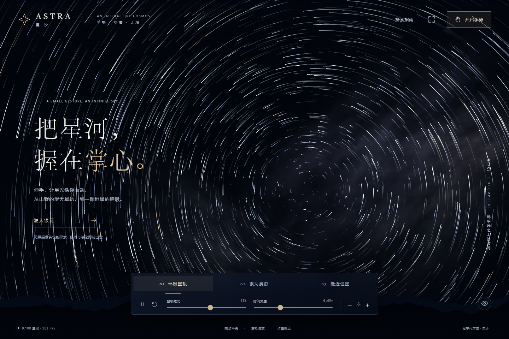

# 星汐 ASTRA

用双手拨动星轨，在浏览器里探索一座程序化数字观星台。包含环极星轨、立体银河和恒星近景；支持手势、鼠标与触屏操作。

[在线体验](https://astra-starfield-liubo.sillymorel15.chatgpt.site/) · [下载离线版](https://github.com/Destin-Lntano/astra-gesture/releases) · [第三方来源与许可](THIRD_PARTY_NOTICES.md)



[查看银河漫游](docs/images/galaxy.png) · [查看恒星近景](docs/images/stellar-closeup.png)

本项目是一件交互数字艺术作品。星体编号、温度、类别、银河结构与空间尺度均为程序化模拟，不是真实星表、天文目录或精确物理仿真。

## 可以体验什么

- **环极星轨**：观察星光随时间运动，调整星轨曝光与时间流速。
- **银河漫游**：转动视角、拉近或拉远，探索立体星海。
- **抵近恒星**：选择可交互恒星，观察模拟表面与日冕。
- **本地手势识别**：张掌转动、双手缩放、捏合选星、握拳暂停。
- **离线运行**：渲染代码、识别组件与模型已随项目提供，不依赖运行期第三方 CDN。

## 快速开始

### Windows 10 / 11

1. 从 [Releases](https://github.com/Destin-Lntano/astra-gesture/releases) 下载完整离线 ZIP，或下载本仓库源码。
2. **完整解压到一个文件夹**，保留 `web`、`launcher` 和 `Start-Astra.cmd` 的相对位置。
3. 双击 **`Start-Astra.cmd`**，浏览器会自动打开本机页面。使用期间请保留启动窗口。
4. 若要用手势，点击网页右上角“开启手势”，再允许摄像头访问；也可直接使用鼠标。

不需要安装 Node.js 或 Python。启动器使用 Windows 自带的 PowerShell 和 .NET，仅监听 `127.0.0.1`，不安装后台服务。若浏览器未自动打开，复制启动窗口中的本机地址到 Chrome 或 Edge。

使用结束时，点击“关闭手势”或关闭网页，再关闭启动窗口。不要在压缩软件里直接运行启动文件，也不要只拷贝 `index.html`。

### macOS / Linux，或自行提供静态网站

使用任意静态 HTTP 服务器提供 `web` 目录即可，无需构建。例如已安装 Python 3 时，在仓库根目录执行：

```sh
python3 -m http.server 8795 --bind 127.0.0.1 --directory web
```

随后打开 `http://localhost:8795`。Windows 中已安装 Python 时也可使用对应的 `python` 命令。

网页使用 ES Modules、Worker 和 WASM，请通过 HTTP 地址打开，不要双击 `web/index.html`。公开部署时使用 HTTPS；摄像头只在 HTTPS 或可信本机地址中可用。

## 操作指南

| 输入方式 | 操作 | 效果 |
| --- | --- | --- |
| 鼠标 | 按住左键拖动 | 转动观测方位 |
| 鼠标 | 滚轮 | 拉近或拉远 |
| 鼠标／触屏 | 点击可选恒星 | 进入恒星近景 |
| 触屏 | 单指拖动／双指开合 | 转动／缩放 |
| 手势 | 张开一只手掌并缓慢移动 | 转动观测方位 |
| 手势 | 双手拉开／收拢 | 靠近／拉远星海 |
| 手势 | 食指与拇指捏合并稍停 | 在指尖指向的位置选星 |
| 手势 | 握拳并稍停，随后松开 | 暂停或继续时间 |
| 键盘 | 空格 | 暂停或继续时间 |
| 键盘 | `R` | 重置当前视角 |
| 键盘 | `H` | 隐藏或显示界面 |
| 键盘 | `Esc` | 返回星海并退出纯净观测 |

底部按钮可切换场景、调整效果、缩放或返回。星轨曝光只对环极星轨场景生效。手势识别需要让手掌完整入镜，均匀光线和简单背景通常更有利于稳定识别；识别并非每次都准确。

## 摄像头与隐私

摄像头默认关闭，仅在使用者主动开启并授权后使用。手部关键点在本地浏览器中推理；项目不上传、录制或保存摄像头画面，也不请求麦克风。

关闭手势或离开页面会停止摄像头视频轨道。没有摄像头或拒绝权限时，鼠标、触屏和按钮仍可探索全部场景。在线体验仍需从托管服务器下载网页与模型；“本地识别”指图像推理在设备内完成。

## 技术结构

这是无需打包构建的静态网页项目，直接编辑 `web` 下的文件并刷新即可。

```text
web/
  index.html             页面与控件
  style.css              布局与视觉样式
  app.js                 场景切换、鼠标/触屏/键盘与手势映射
  cosmos.js              Three.js 场景与程序化星空
  hands.js               摄像头生命周期与手势判定
  hand-worker.js         后台手部关键点推理
  one-euro.js             手势平滑滤波器
  models/                本地 Hand Landmarker 模型
  vendor/                Three.js、MediaPipe 与 WASM
  licenses/              第三方完整许可证
launcher/
  Start-Astra.ps1         Windows 启动与退出
  AstraServer.cs          仅监听本机的静态 HTTP 服务
Start-Astra.cmd           Windows 双击入口
```

识别优先在 Worker 中运行，GPU 不可用时尝试 CPU；部分浏览器会退回主线程推理。渲染、识别和界面使用的第三方组件版本固定，随仓库分发。

## 兼容性与限制

- 建议使用支持 WebGL、WebAssembly 和 ES Modules 的新版桌面 Chrome 或 Edge，并启用图形加速。其他浏览器、手机及内嵌浏览器的摄像头、Worker、全屏和性能表现可能不同。
- 低性能设备可在“关于”中将画质改为“流畅优先”，或关闭手势使用鼠标操作。
- 首次开启手势需加载本地模型；识别速度受设备、光照、遮挡与手掌位置影响。本项目不承诺固定帧率或识别准确率。
- Windows 启动器仅适用于允许运行 PowerShell/.NET 的 Windows 环境。如果学校或单位设备限制脚本运行，可使用在线演示。
- 手机不能直接运行 Windows 启动器；请打开在线链接，或由适当的静态服务器提供网页。
- 本地启动器用于个人体验，不应作为公网生产服务器使用。

## 开源许可与致谢

本项目原创代码采用 [MIT License](LICENSE)，版权所有 © 2026 刘博（Destin-Lntano）。第三方代码和模型继续使用各自的许可证，不受本项目 MIT 声明替代。

- [Three.js](https://github.com/mrdoob/three.js)：r160，MIT，三维渲染。
- [MediaPipe Tasks Vision](https://github.com/google-ai-edge/mediapipe)：0.10.21，Apache-2.0，手部关键点推理。
- Google 官方 Hand Landmarker 模型：`hand_landmarker/float16/1`，Apache-2.0。
- [Wlarskog/gesture-particles](https://github.com/Wlarskog/gesture-particles)：MIT，移植其中的 One Euro Filter；本项目的星空场景与交互逻辑另行实现。

完整版本、模型来源和许可证链接见 [THIRD_PARTY_NOTICES.md](THIRD_PARTY_NOTICES.md)；网页内也可打开 [制作说明](web/credits.html)。欢迎通过 Issues 提交可复现的问题或改进建议。

项目由刘博提出需求与迭代方向，使用 AI 辅助开发、整理文档和测试。当前为早期公开版本，欢迎一起改善不同设备上的体验。
